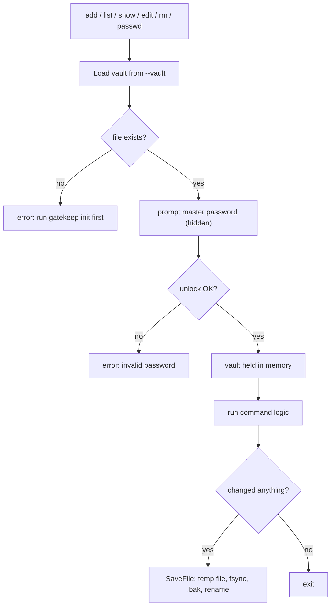
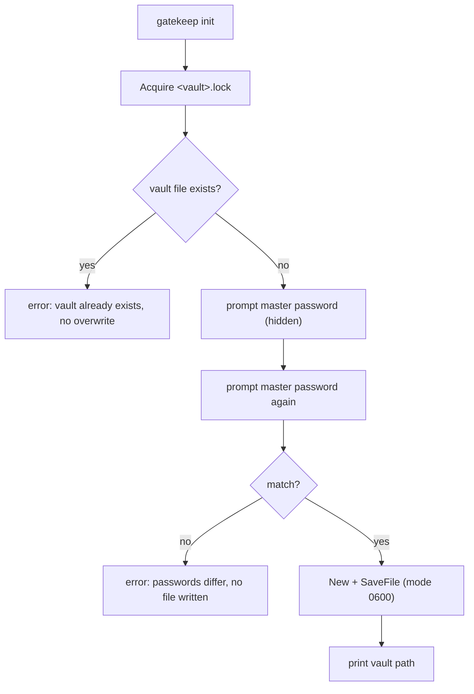
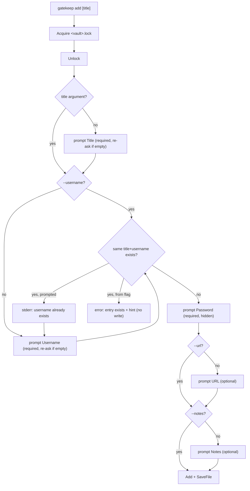
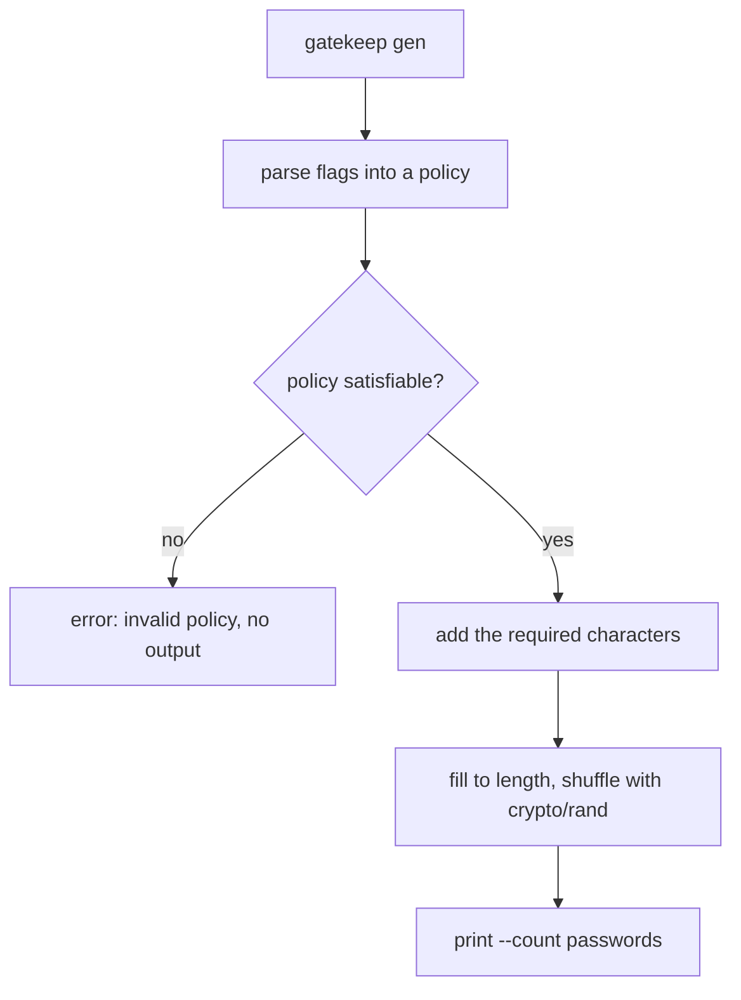
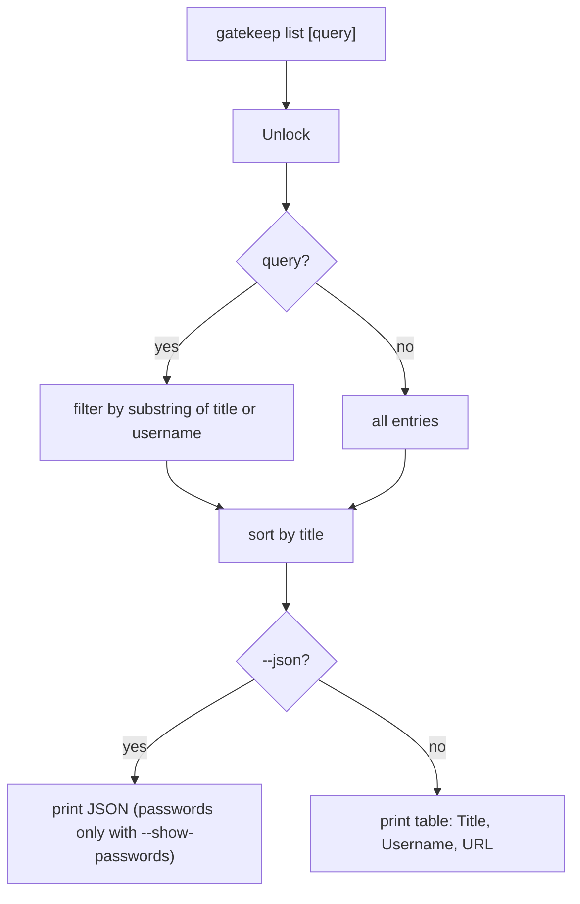
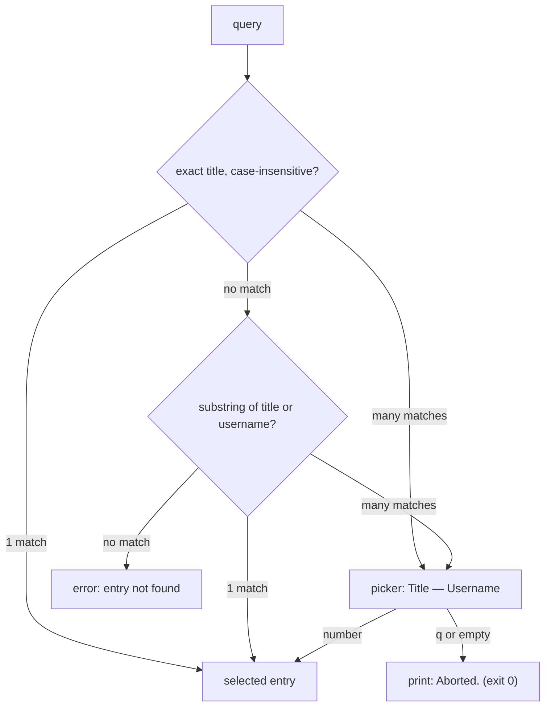
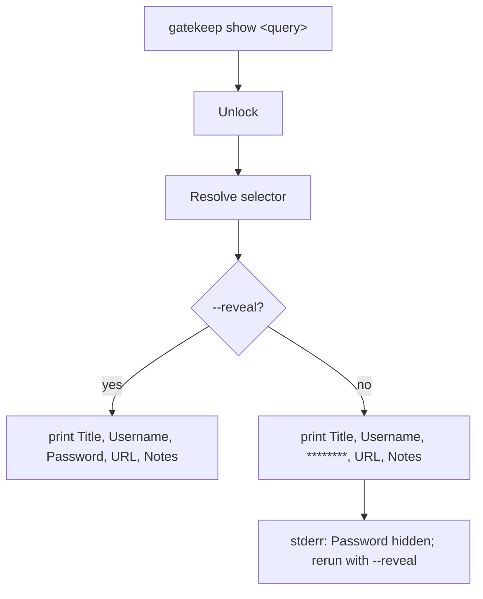
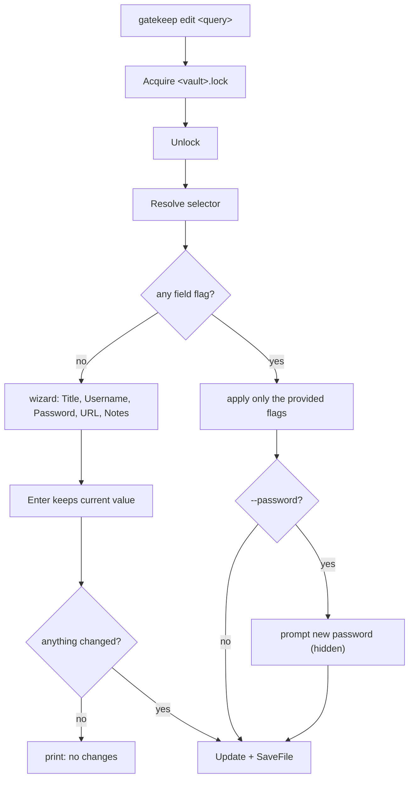
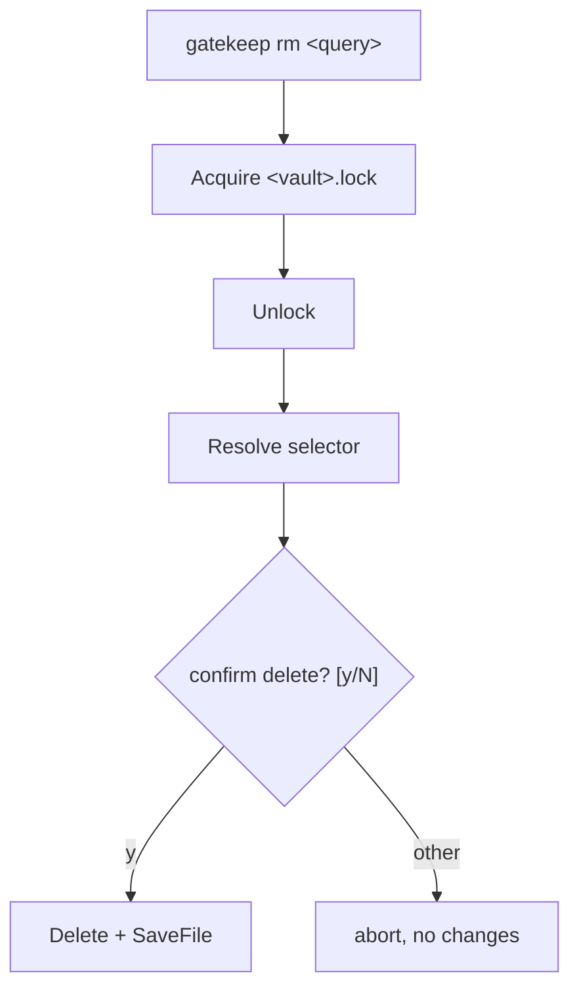
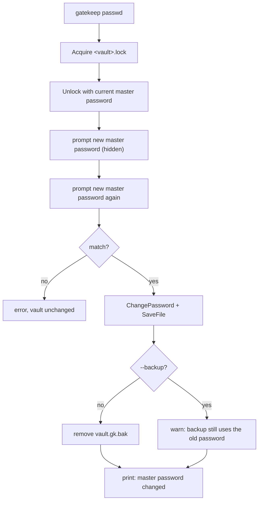

# CLI flows

- Mermaid diagrams of the `gatekeep` command flows.
- All commands except `init` and `gen` share the unlock/save lifecycle below.
- Mutating commands (`init`, `add`, `edit`, `rm`, `passwd`) take an exclusive lock on `<vault>.lock`; `list` and `show` do not.
- `gen` is standalone: it never reads the vault, prompts for a master password, or takes a lock.
- Prompts require a terminal; there is no scripting mode.

## Shared unlock and save

## `init`

## `add`

`title`, `username`, and `password` are required. `url` and `notes` are
optional and skipped with an empty line. A field supplied as an argument or
flag is not prompted. The password is always prompted (there is no password
flag).

Before the password prompt, `add` refuses an entry whose title and username
already exist. Titles compare case-insensitively (`gmail` matches `Gmail`);
usernames compare exactly (`ALICE@gmail.com` does not match
`alice@gmail.com`). A matching username under a different title, or a matching
title under a different username, is allowed.

A prompted username that duplicates an entry is warned about on stderr and
asked again, so a typo does not cost the title. A duplicated `--username` flag
is an error instead, because flags are explicit: the error names the existing
entry and suggests `gatekeep edit`. Ctrl-C cancels the re-prompt loop, and
nothing is written until the entry is complete.

## `gen`

`gen` never reads the vault, so it needs no master password and takes no lock.
It prints one password per line on stdout. A policy that cannot be satisfied
fails before anything is printed.

## `list`

## Selector resolution (`show`, `edit`, `rm`)

## `show`

The password is masked by default; `--reveal` prints it. The mask has a fixed
length so the real password length does not leak. The hint goes to stderr, so
stdout stays parseable, and an entry without a password is printed unmasked.

## `edit`

With at least one field flag, only the provided flags are applied. With no
field flags, an interactive wizard asks for every field and Enter keeps the
current value. Title and username cannot be set empty; clear the optional
fields with `--url=` or `--notes=`.

## `rm`

## `passwd`

