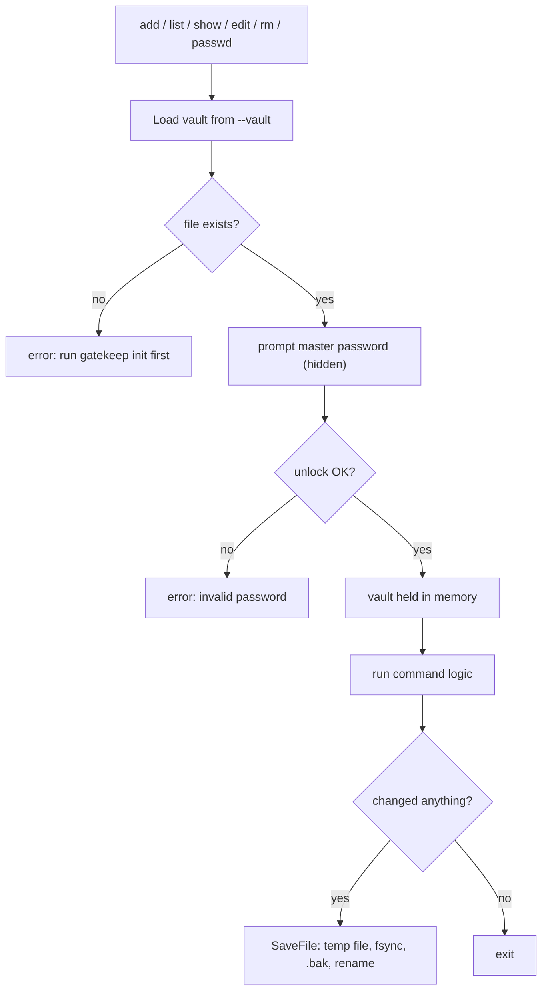
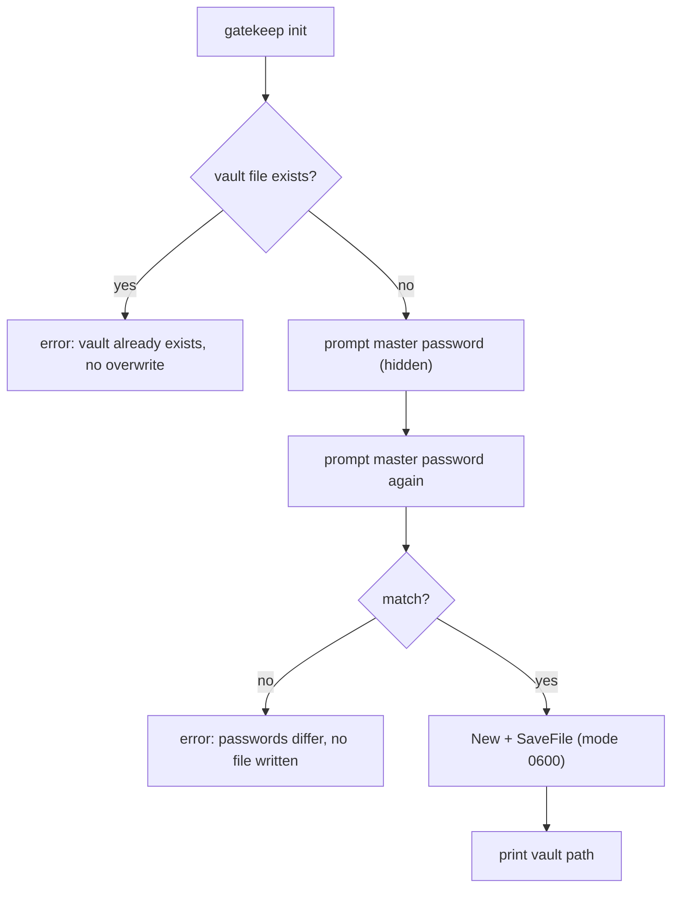
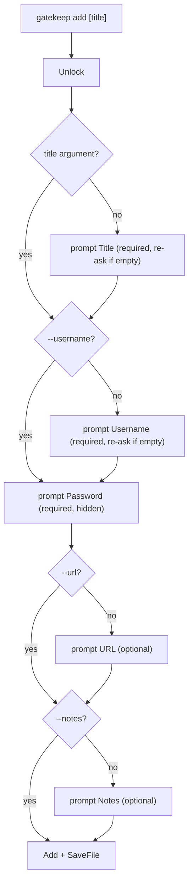
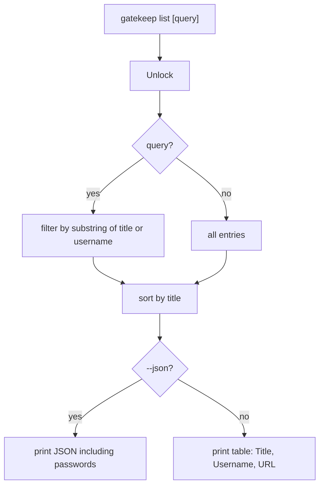
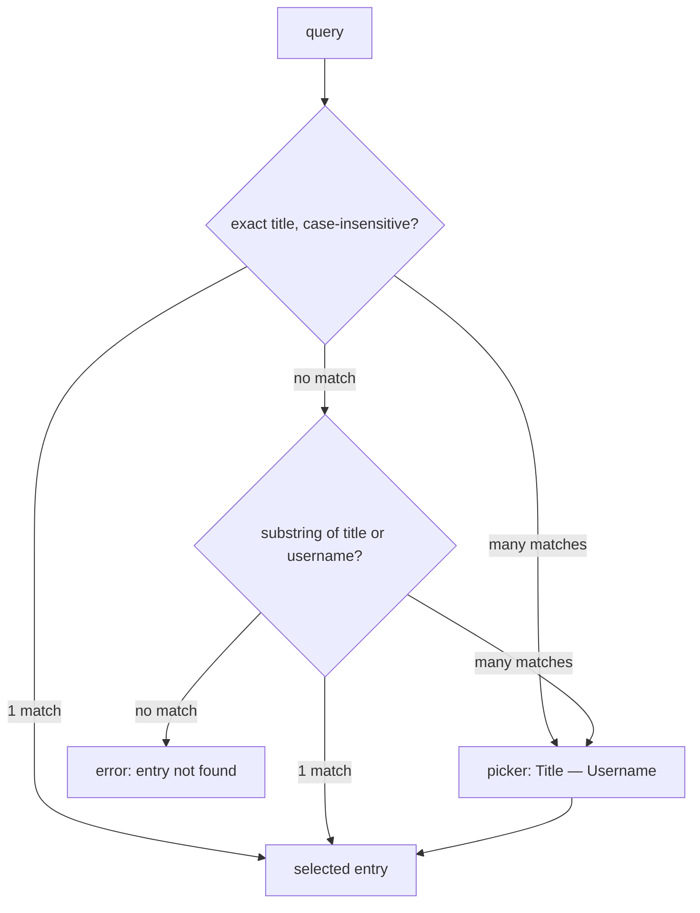
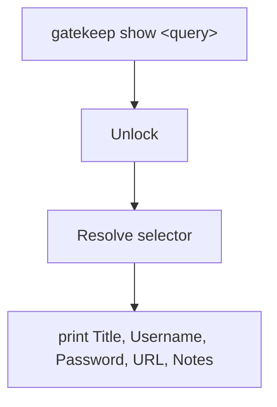
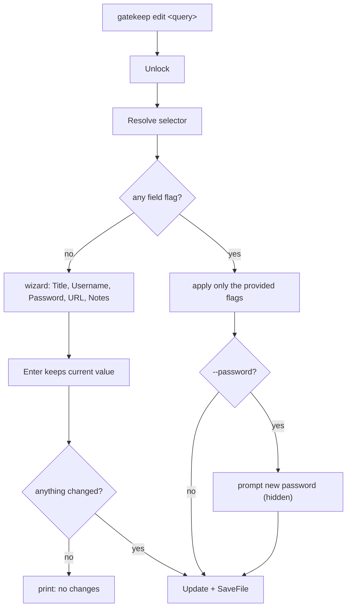
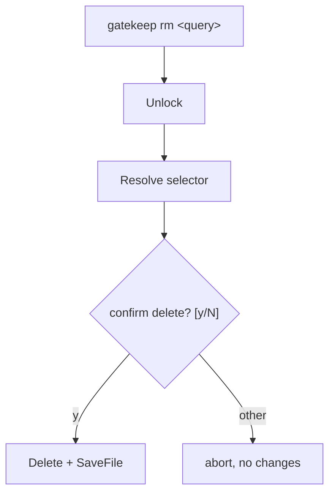
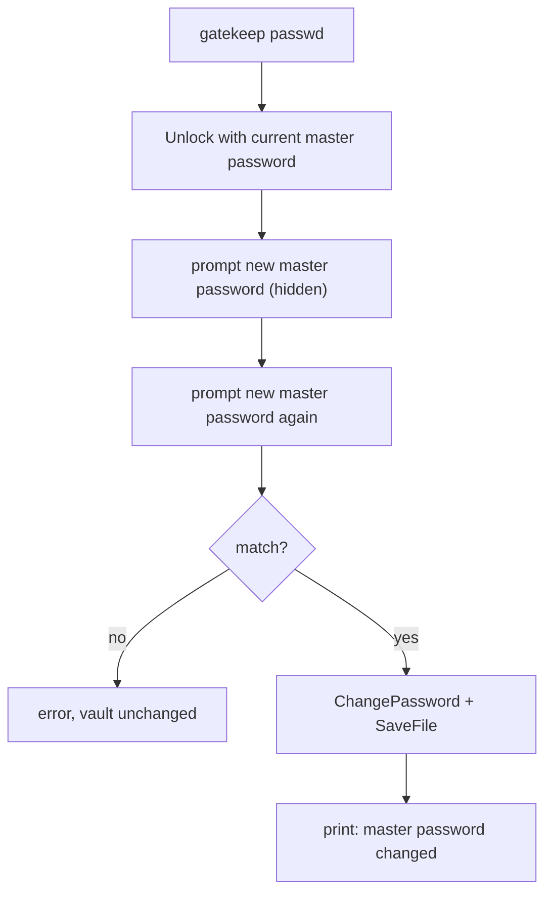
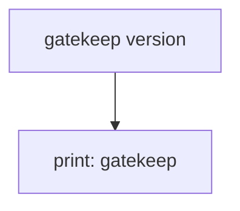

# CLI flows

Mermaid diagrams of the `gatekeep` command flows. They describe the intended
M5 behavior: `version`, `init`, `add`, `list`, `show`, `edit`, and `rm` are
implemented; the other commands are wired in the command tree but return
`not implemented yet` until later milestones.

All commands except `init` and `version` share the unlock/save lifecycle
below. Prompts require a terminal; there is no scripting mode.

## Shared unlock and save

## `init`

## `add`

`title`, `username`, and `password` are required. `url` and `notes` are
optional and skipped with an empty line. A field supplied as an argument or
flag is not prompted. The password is always prompted (there is no password
flag).

## `list`

## Selector resolution (`show`, `edit`, `rm`)

## `show`

## `edit`

With at least one field flag, only the provided flags are applied. With no
field flags, an interactive wizard asks for every field and Enter keeps the
current value. Title and username cannot be set empty; clear the optional
fields with `--url=` or `--notes=`.

## `rm`

## `passwd`

## `version`

